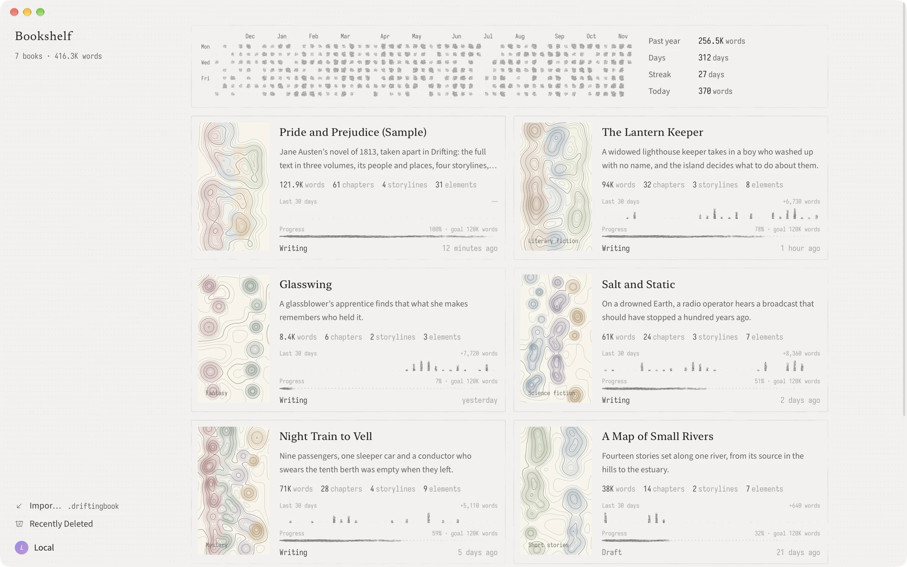
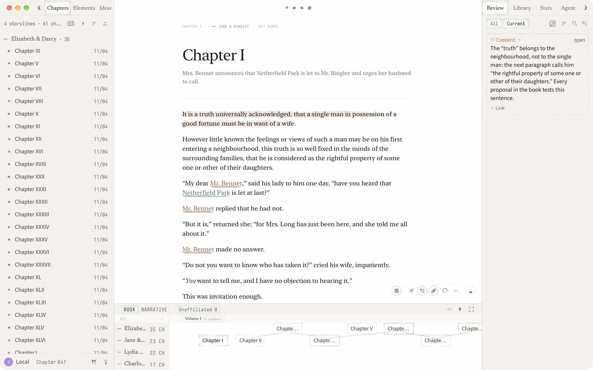
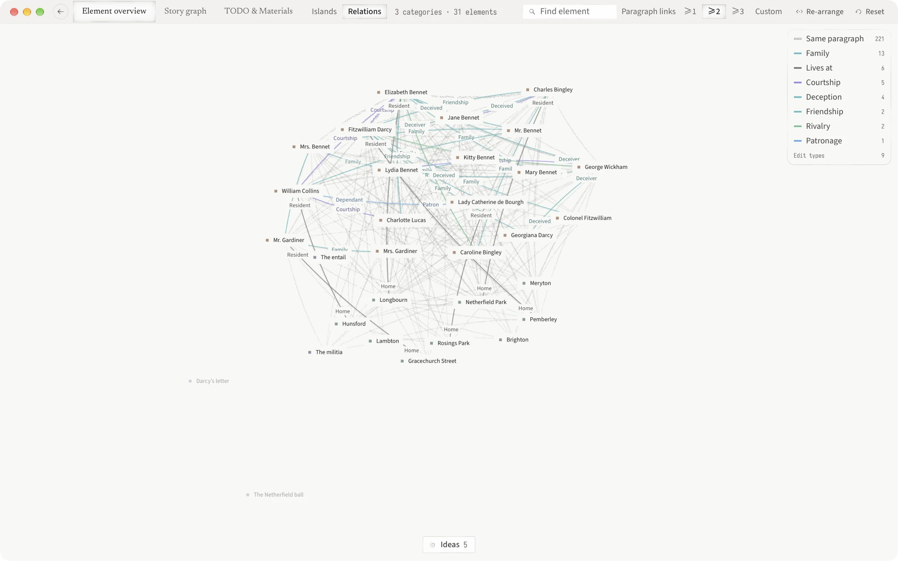

# Drifting

An open-source, local-first novel writing app for Mac and Windows.

**The ease of a Markdown editor, the scaffolding of a classic writing studio, and
an Agent for the whole book.**

[Download for Mac and Windows](https://github.com/chihumyum/Drifting/releases/latest) ·
[Website](https://drifting.cc/) · [Documentation](docs/README.md)

macOS 13+ · Windows 10/11 · Early development

English | [简体中文](README.zh-CN.md)

Interface: 简体中文 · 繁體中文 · English · 日本語 · 한국어 · Español · Deutsch · Français · Português (Brasil). [Localization](docs/internationalization.md).







Drifting is an open-source, local-first novel writing app for Mac and Windows. It writes
like a Markdown editor, builds a book the way classic writing studios like
Scrivener do — chapters and outline, characters and world, storylines and
research — and comes with an AI Agent that can read, search and edit the whole
project.

**Early development.** Drifting is used daily by its author and changes often.
Keep independent copies of manuscripts that matter, and read the
[known issues](KNOWN_ISSUES.md).

## Download

From [GitHub Releases](https://github.com/chihumyum/Drifting/releases/latest):

- **Mac**: macOS 13 or later on Apple Silicon. Download the `.dmg`.
- **Windows** (preview): Windows 10 or 11. Download
  `Drifting_<version>_windows_x64-setup.exe`, or `…_arm64-setup.exe` for a PC
  with an Arm processor, and run it; it needs no administrator rights. See
  [Windows](docs/windows.md).

The app tells you when a new version is out; you choose when to install it.
The first launch opens two sample projects you can explore or delete: *Pride
and Prejudice*, and Lu Xun's *The True Story of Ah Q* (in Chinese), left half
written for you to go on.

## Writes like a Markdown editor

- One quiet page and the keyboard. Type `#`, `##` or `###` to start an H1, H2
  or H3; `**bold**`, `*italic*`, `>` and `---` take shape as you type.
- Every project is also a folder of Markdown files. Edit chapters and ideas in
  Obsidian or any text editor, and the changes merge back into Drifting.
- Copy or save any document, or the whole book, as Markdown. Import `.md`,
  `.txt` and `.docx`.

## The scaffolding of a classic writing studio

- Write chapter by chapter, or read and edit the whole book in one view.
- Acts sit on the timeline; inside a chapter, H1, H2 and H3 are three levels
  you give your own meaning, listed in the outline beside the text.
- **Ideas** hold fragments that have not found a place yet. Turn one into a
  chapter or an element when it is ready.
- **Elements** for characters, places, objects and lore, grouped into
  categories. **Patches** record how an element changes, next to the passage
  that changes it. Typed **relations** connect elements, chapters and
  storylines.
- **Storylines**, a timeline in book order or narrative time, and a plot grid for
  each chapter.
- **Materials** for research: notes, images and PDFs in folders, each opening as
  a tab. Comment on a region of an image or PDF.
- Full-window views: **Element overview**, **Story graph**, and **TODO &
  Materials**. **Project Home** gathers progress, quick creation and the Agent's
  proactive suggestions.
- Comments and TODOs are anchored to the text. History snapshots, word counts,
  daily goals and streaks.
- Export the book, or chosen chapters, as EPUB, PDF or Word.

## An Agent for the whole book

- Bring your own key for DeepSeek, Anthropic or OpenAI, or sign in with a
  ChatGPT subscription (experimental). Writing never requires AI.
- The Agent reads, searches and edits your project: prose, elements, relations,
  storylines, materials, TODOs. Its edits are marked in the text and can be
  undone from history.
- Project Memory keeps the preferences and rules you give it. TODOs, chapter
  reviews and suggestion cards can run as background Agent sessions.
- After you write, Project Home offers to file what you wrote into elements,
  patches and relations; it runs only when you open that card and never edits
  prose on its own.
- **External agents**: Codex, Claude Code and Antigravity can connect to one
  project through MCP, read-only by default. See
  [external agent setup](docs/agent-runtime/local-mcp.md).

## Your data

- Everything is stored on your computer and works offline. No account needed.
- Export every project as a Markdown ZIP, or back up the whole library as a
  restorable `.drifting` file.
- Deleted projects stay in Recently Deleted for 30 days.

With an account you can sync between computers and share a chapter as a web page
that readers can comment on. Synced projects are not end-to-end encrypted. See
the [privacy policy](https://drifting.cc/privacy) and
[terms](https://drifting.cc/terms).

## Compared with Scrivener and Novelcrafter

Scrivener is a long-standing desktop writing studio with no built-in AI;
Novelcrafter is a web app for writing with AI that needs a connection. Drifting
keeps the scaffolding of the first and adds an Agent for the whole book, in a
free, open-source app for Mac and Windows that keeps your manuscripts on your
computer as Markdown files.

| | Drifting | Scrivener | Novelcrafter |
| --- | --- | --- | --- |
| Runs as | Mac and Windows apps | Mac, Windows and iOS apps | Web app |
| Price | Free | One-time purchase | Subscription |
| Source | Open source (AGPL) | Closed | Closed |
| Offline | Yes | Yes | Needs a connection |
| AI | An Agent for the whole project, on your own key | None built in | Your own key or a local model |

## Help

[Support](https://drifting.cc/support) · [Known issues](KNOWN_ISSUES.md) ·
[Report a bug](https://github.com/chihumyum/Drifting/issues) ·
[Security](SECURITY.md)

## Build from source

Drifting is built with Tauri, Rust, React and TypeScript. Source builds run
locally without an account; the Hosted sync service is operated separately and
is not part of this repository. Running on macOS needs Xcode and your own Apple
Development certificate; see the [contributor quick start](docs/contributor-quick-start.md).
On Windows, see [Developing on Windows](docs/windows.md#developing-on-windows).

```bash
pnpm install --frozen-lockfile
pnpm dev:check
pnpm dev
```

[Documentation](docs/README.md) · [Contributing](CONTRIBUTING.md) ·
[Releasing](docs/releasing.md)

## License

Project source is [AGPL-3.0-or-later](LICENSE); `packages/prose-metrics` is
[Apache-2.0](packages/prose-metrics/LICENSE). Third-party code and assets keep
their own licenses.

[Third-party notices](THIRD_PARTY_NOTICES.md) · [Trademarks](TRADEMARKS.md) ·
[Client privacy boundary](PRIVACY.md) · [Source history](docs/public-history.md)
