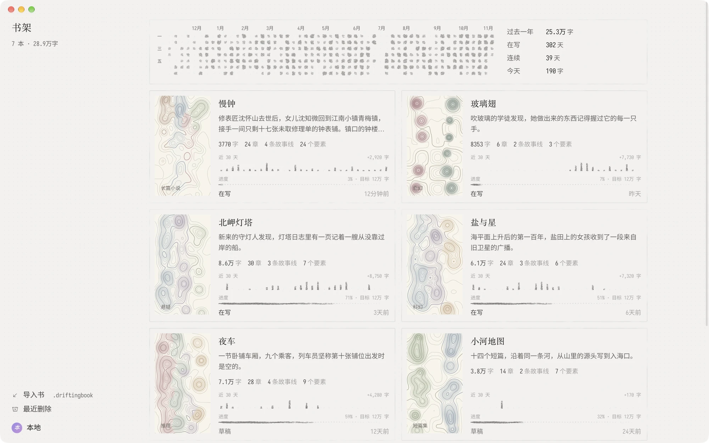
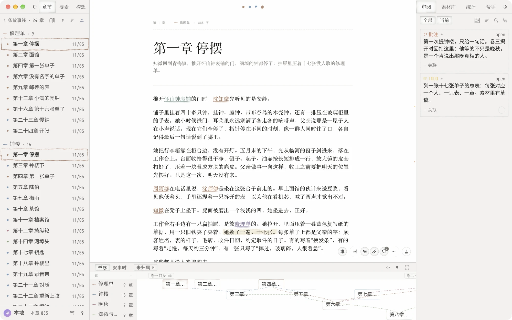
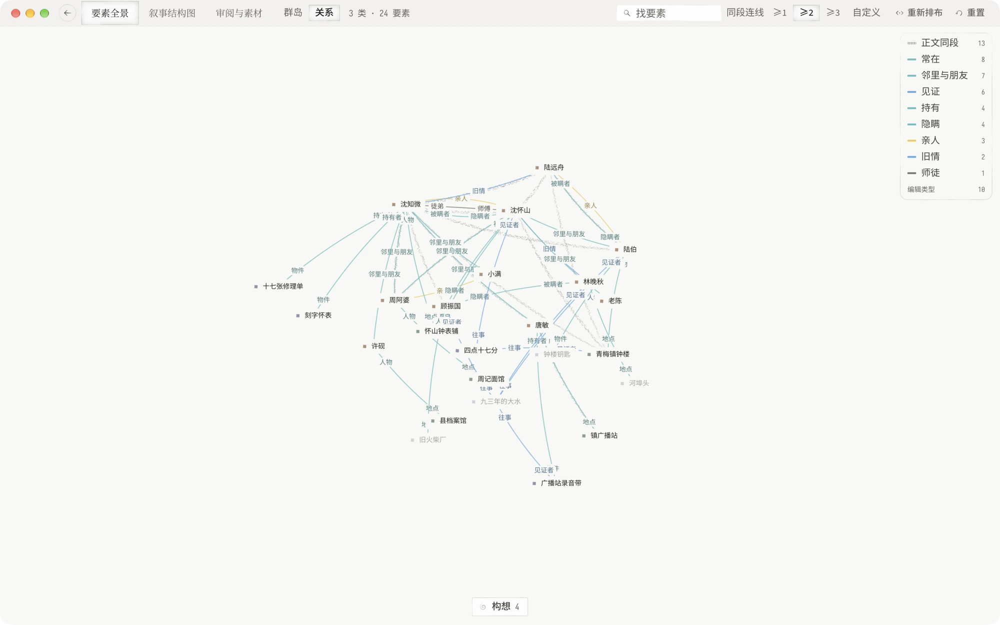

# Drifting

跨平台的 AI 原生小说写作应用。

**兼具 Markdown 编辑器的轻快、经典写作工坊的创作框架，以及贯穿全书的 AI Agent，助你写出人生第一部畅销书。**

[下载 Mac 与 Windows 版](https://github.com/chihumyum/Drifting/releases/latest) ·
[官网](https://drifting.cc/zh) · [文档](docs/README.md)

macOS 13+ · Windows 10/11 · 早期开发中

[English](README.md) | 简体中文

界面语言：简体中文 · 繁體中文 · English · 日本語 · 한국어 · Español · Deutsch · Français · Português (Brasil)。[本地化说明](docs/internationalization.md)。







Drifting 是一个开源、本地优先的长篇小说写作软件，支持 Mac 与 Windows。写起来像 Markdown 编辑器；
像 Scrivener 这类传统写作软件那样，用章节和大纲、人物和世界设定、故事线和资料把一本书搭起来；
还有一个能读、能查、能动手修改整个项目的 AI Agent。

**仍在早期开发。** 作者每天都在用它写作，它也在频繁变化。重要的稿件请另外保留副本，
并先看一下[已知问题](KNOWN_ISSUES.md)。

## 下载

在 [GitHub Releases](https://github.com/chihumyum/Drifting/releases/latest) 下载：

- **Mac**：Apple Silicon 上的 macOS 13 及以上，下载 `.dmg`。
- **Windows**（预览版）：Windows 10、11，下载 `Drifting_<版本号>_windows_x64-setup.exe`，
  ARM 处理器的电脑下载 `…_arm64-setup.exe`，运行即可安装，不需要管理员权限。见
  [Windows](docs/windows.md)。

有新版本时 App 会提示，何时安装由你决定。第一次打开会带两本示例作品：《傲慢与偏见》，和写到一半、可以接着写的《阿Q正传》，可以随便看，也可以删掉。

## 像 Markdown 编辑器一样写

- 一张安静的稿纸，手不离键盘。输入 `#`、`##`、`###` 就开始一个 H1、H2 或 H3；
  `**粗体**`、`*斜体*`、`>` 和 `---` 边打边成形。
- 每个项目同时也是一个 Markdown 文件夹。在 Obsidian 或任何文本编辑器里改过的章节和构想，
  会合并回 Drifting。
- 单篇或整本书都可以复制、保存为 Markdown；可以导入 `.md`、`.txt`、`.docx`。

## 传统写作软件的脚手架

- 按章写，也可以在一个视图里通读、修改整本书。
- 幕在时间线上设置；章节里的 H1、H2、H3 是三个层级，含义由你自己定，列在正文旁的大纲里。
- **构想**收留还没有位置的片段，成熟后可以转成章节或要素。
- 用**要素**整理人物、地点、物品和设定，并归入分类；用**补丁**记录要素随情节发生的变化，
  紧挨着引起变化的那段原文。要素、章节、故事线之间可以建立带类型的**关联**。
- **故事线**、按书序或叙事时间排列的时间线，以及每章一张情节表。
- **素材**收资料：笔记、图片和 PDF，可以分素材夹，各自在标签页里打开；可以在图片或 PDF
  的某个区域上批注。
- 全窗口视图：**要素全景**、**叙事结构图**、**TODO & 素材库**。**作品主页**汇总进度、
  快速新建和 Agent 的主动建议。
- 批注和 TODO 锚定在正文上。历史快照、字数统计、每日目标与连续写作天数。
- 整本书或选定章节可以导出为 EPUB、PDF、Word 成稿。

## 照看整本书的 Agent

- 可以用自己的 DeepSeek、Anthropic、OpenAI 密钥，也可以登录 ChatGPT 订阅（实验性）。
  不用 AI 也能正常写作。
- Agent 能读、搜索和修改你的项目：正文、要素、关联、故事线、素材、TODO。它的改动会在正文里标出，
  可以从历史快照撤回。
- 项目记忆保存你交代给它的偏好和规则。TODO、章末审读和主动建议卡片都可以交给后台 Agent 处理。
- 写完之后，作品主页会提议把新写的内容整理进要素、补丁和关联，你点了这张卡才做；它不会自行改动正文。
- **外部 Agent**：Codex、Claude Code、Antigravity 通过 MCP 连接一次，就能读写你当前打开的那本书。
  见[外部 Agent 接入](docs/agent-runtime/local-mcp.md)。

## 你的数据

- 所有内容保存在你的电脑上，断网也能写，不需要账号。
- 所有项目可以导出为 Markdown ZIP；整个资料库可以备份成能恢复的 `.drifting` 文件。
- 删除的项目会在「最近删除」里保留 30 天。

注册账号后，可以在多台电脑之间同步，并把章节分享成网页给读者阅读和评论。同步内容没有端到端加密。
详见[隐私政策](https://drifting.cc/privacy)和[服务条款](https://drifting.cc/terms)。

## 和 Scrivener、Novelcrafter 的区别

Scrivener 是老牌的桌面写作软件，没有内置 AI；Novelcrafter 是带 AI 的网页写作工具，需要联网。
Drifting 保留了前者的脚手架，加上一个照看整本书的 Agent，做成一个免费、开源的 Mac 与 Windows 应用，
稿件以 Markdown 文件的形式存在你的电脑上。

| | Drifting | Scrivener | Novelcrafter |
| --- | --- | --- | --- |
| 形式 | Mac 与 Windows 应用 | Mac、Windows、iOS 应用 | 网页应用 |
| 价格 | 免费 | 一次性购买 | 订阅 |
| 源码 | 开源（AGPL） | 不公开 | 不公开 |
| 离线 | 可以 | 可以 | 需要联网 |
| AI | 读写整个项目的 Agent，用你自己的密钥 | 没有内置 | 用你自己的密钥或本地模型 |

## 帮助

[支持](https://drifting.cc/support) · [已知问题](KNOWN_ISSUES.md) ·
[报告问题](https://github.com/chihumyum/Drifting/issues) · [安全问题](SECURITY.md)

## 从源码构建

Drifting 使用 Tauri、Rust、React 和 TypeScript。源码构建在本地运行，不需要账号；Hosted
同步服务另行运营，不在此仓库中。在 macOS 上运行需要 Xcode 和你自己的 Apple Development 证书，
见[开发环境配置](docs/contributor-quick-start.md)；在 Windows 上见
[在 Windows 上开发](docs/windows.md#developing-on-windows)。

```bash
pnpm install --frozen-lockfile
pnpm dev:check
pnpm dev
```

[文档索引](docs/README.md) · [参与开发](CONTRIBUTING.zh-CN.md) · [发布流程](docs/releasing.md)

## 许可

项目源码采用 [AGPL-3.0-or-later](LICENSE)；`packages/prose-metrics` 采用
[Apache-2.0](packages/prose-metrics/LICENSE)。第三方代码和素材保留各自的许可证。

[第三方声明](THIRD_PARTY_NOTICES.md) · [商标说明](TRADEMARKS.md) ·
[客户端隐私边界](PRIVACY.md) · [源码历史说明](docs/public-history.md)
