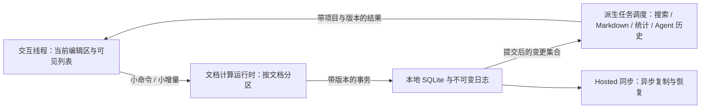

# 重型写作工作流：性能目标与架构演进

本方案回应“极高、极重的写作工作流仍极为流畅”的目标。它扩展现有优化计划；下文的预算与阶段是拟定的工程目标，不是已达到的产品承诺。先缩小每个操作的工作范围，再用实测决定线程与存储边界的迁移，避免迁移后仍执行同样的全量工作。

## 已知证据与瓶颈归属

[第一轮修复](stress-seed-performance-fixes-2026-10-29.md)处理了七类发现，但最终 Debug 观察仍有约 0.5 秒帧尾部、25 个常驻编辑器和约 1.3 GiB WebContent RSS。RSS 包含 WebKit 与 AX，尚不足以认定泄漏。Agent 的正文历史虽然入口有界，主动载入后仍可无限增长。

源码确认后台 Markdown 投影在捕获前调用 `flushAllOpenYjsDocuments`，每个 session 的 `flushLocalState` 原来无条件完整编码、写快照和压缩；无修改保存也随已开文档数量增长。这与“交互成本由实际改动决定”的目标不符。

旧 Node 的约 0.6 秒整章替换并不等于原生键入延迟：诊断从 `executeOfflineWorkspaceTool` 进入，每次先重新加载项目投影，还包含自动全文预读、Agent receipt/校验和正文写入。该调用路径不能直接用于判断普通作者每次击键的瓶颈，也不能跳过并发校验来换取较低数值。下一次分析应分别计时 CLI bootstrap、工具 preflight、授权/版本验证、Yjs 命令、事务和投影发布。

## 预算与测试矩阵

先以指定参考机的 production/release 构建校准，再设自动回归门槛。以下是初始目标：

| 路径 | 拟定目标 | 对应约束 |
| --- | --- | --- |
| 击键、选区、中文输入法 | 同步 JS p95 ≤ 4 ms；p99 ≤ 8 ms | 不做整本文字提取、全表读取、全文编码、布局扫描；输入法候选确认与撤销单独验收 |
| 热标签、侧栏响应 | 可见反馈 p95 ≤ 50 ms；内容就绪 p95 ≤ 100 ms | 无关编辑器不更新；反馈和数据完成分别计时 |
| 滚动、缩放、拖拽 | 60 Hz 下稳定于每帧 16.7 ms；120 Hz 设备另验 8.3 ms | 主动交互阶段禁止后台任务连续占用主线程超过 8 ms；50 ms 以上任务必须归因 |
| 无改动保存、空闲后台刷新 | 0 次正文全量编码、0 次快照重写 | 持久化屏障继续验证尾部并排空写入 |
| 一字符保存 | 工作量随变更文档/块增长 | 与项目总字数、标签总数、历史会话总数解耦；原子提交保持不变 |
| 内存 | 先证明重复工作流后可回到稳定区间 | 同时记录 JS retained heap、native physical footprint 和 RSS；不用单个 RSS 数值当泄漏判据 |

三个规模：当前 stress；10 倍 stress；病理单文档（20 万字、密集链接、长历史）。组合 1/25/100 个标签、1/4 个可见编辑区、长会话边输出边写作、搜索/导出/同步并行。采集冷/热、连续输入、持续两小时、多轮打开关闭；分别测全新正文与多轮修改/删除后的 Yjs 历史、同步重放与大批 Agent 编辑。计时按交互窗口统计，保留所有尾部样本，避免空闲帧稀释 p95。

## 推荐的目标边界



- **交互线程**拥有当前 ProseMirror 编辑视图、DOM selection、IME 和即时反馈。React 管理布局与少量订阅；编辑器 transaction 不推动整个应用重渲染。`startTransition` 不能替代 CPU 隔离，外部 store 更新还可能退回阻塞渲染。[React 文档](https://react.dev/reference/react/useSyncExternalStore)
- **文档计算运行时**按文档排队，合并可合并的派生请求，优先交互，后台任务可取消且有时间片/内存上限。关闭文档停止派生计算，仍正确排空 canonical 写入。优先把纯计算留在 TypeScript Worker，避免同时维护两套 prose 语义。
- **本地数据层**拥有 SQLite 事务、日志和资产边界；UI 查询使用明确字段与分页，正文按需读取。跨桥传的是小命令、二进制更新和窄结果，减少大 JSON 与 Uint8Array→数字数组复制。Rust 可以承接批量读取、压缩和持久化，但不能形成绕过既有 domain validator 的第二写入路径。
- **派生任务层**消费提交后的变更集合，按文档 revision 失效。合并多个过时任务、主动交互期间退让，结果携带项目/文档/代际，过时结果丢弃；用户明确导出时才等待指定一致性屏障。
- **Hosted**负责复制、跨设备和恢复；离线写作的反馈和本地落盘不依赖网络往返。私有服务架构没有在本仓库检查，服务端调整需要单独测量与版本化契约。

## 实施次序与架构选择

| 阶段 | 变更 | 升级到下一阶段的判据 |
| --- | --- | --- |
| A：减少重复工作 | 本轮先实现未变化 Yjs 快照复用；随后为投影/搜索建立文档级变更集合和窄查询；拆分 Agent preflight 与 CLI bootstrap 指标 | 确认一次改动不再反复物化同一文档，记录 CPU/分配/桥接字节数 |
| B：限制常驻对象 | 标签元数据与编辑视图寿命分开；只挂载可见区及少量热视图，文档与 undo 生命周期独立；长会话滚动窗口、图与全书视口裁剪 | 100 标签下 DOM 与可见视图数量相关；跨标签 undo、选区、滚动、输入法、Agent 背景编辑全部通过 |
| C：文档与索引后台化 | 有界 Worker 池；按 revision 缓存纯计算结果；搜索索引增量更新；大型读写命令后台准备、主线程只应用必要编辑增量 | 能证明交互连续占用低于预算；不存在 Worker 排队饥饿、整本书重复传输或过期提交 |
| D：本地数据服务 | 若 SQLite bridge/序列化仍占显著时间，再把事务/窄 read model 经版本化命令放入 Rust；新索引追加迁移并通过安全快照路径 | 命令级 before/after 明确，跨平台恢复、旧数据库升级、同步与原子性不变 |
| E：编辑内核替换实验 | 只有当前编辑区本身在分离派生工作后仍不达标，才对照 Lexical、原生文本组件或专门的分页内核 | 同一重负载及真实中文 IME 下有量化收益，并覆盖富文本/Yjs/撤销/批注/链接/多平台兼容成本 |

推荐沿 A→B→C 推进，D 由桥接与事务证据决定。立即替换 React 或把所有数据搬到服务器，无法保证消除全量编码、复制和无界对象。Tiptap 的官方性能指南也把隔离编辑器与无关更新列为首要措施；本项目需要自己的真实压力验收。[Tiptap 文档](https://tiptap.dev/docs/guides/performance)

B 阶段不能直接卸载整个编辑器来丢掉 undo。可先将 EditorState/Y.UndoManager 与 EditorView 拆开：热视图复用、温文档保留撤销与 CRDT、冷文档安全排空后释放。若把活跃 Y.Doc 移到 Worker，需要明确主线程编辑状态和 Worker CRDT 的协议、选择映射、输入法组合期与回放顺序，这是独立架构里程碑。

C 阶段的二进制合并也不是免费 GC。Yjs 支持合并与差分二进制更新，但清理删除内容仍需要加载 Y.Doc；因此后台合并和有界快照应一起设计。[Yjs 文档](https://docs.yjs.dev/api/document-updates)

## A1：本轮已实现的快照复用

`YjsDocumentSession` 记录当前内容事件版本、上次快照覆盖的持久化行号与成功压缩行号。屏障仍逐一核对持久化尾部并排空异步写入；只有内容或覆盖游标改变才完整编码、写快照。版本在异步 I/O 前捕获，期间的新输入不会被标记为已保存；缺少前序依赖的 Yjs tail 即使没有内容事件，覆盖游标也会强制快照。删除更新不以 state vector 作为唯一判断。失败不会推进成功状态，压缩可重试；无修改关闭不额外生成相同历史快照。

机器证据由 `scripts/measure-yjs-durability.ts` 生成：[before](acceptance/yjs-durability-before.json)、[after](acceptance/yjs-durability-after.json)。真实 Yjs + production session，25 份合成文档，内存存储适配器；20 次空闲屏障的完整快照由 500 次 / 约 32 MB 降为 0；只改一份文档从写 25 份降为 1 份。25 份正文均从持久化状态重建一致。时间是该合成适配器的 CPU 诊断，不代表真实 SQLite、键入或 release 性能。

```sh
node --expose-gc --conditions=import --import=tsx scripts/measure-yjs-durability.ts --assert-incremental
```

## B1：保留文档与撤销，跳过隐藏视图渲染

A1 后的[独立原生记录](acceptance/heavy-workflow-rendering-before.json)在关闭标签阶段仍捕获 1,675 ms 帧间隔、1,626 ms 定时器迟到；[看门狗](acceptance/heavy-workflow-rendering-stall.json)确认 renderer blocked。同阶段 React 渲染最大 14 ms，数据库 IPC 最大约 1,645 ms，不能把全部延迟归给 React 或数据库。[原生栈信号摘要](acceptance/heavy-workflow-rendering-stack.json)对应的三秒采样跨越恢复，其中可见 WebCore 的 updateRendering → updateLayout → resolveStyle → collectMatchingRules；这是布局/样式计算参与的证据，不是各函数占整个停顿的比例，也不是 forced-layout 次数。

本轮增加 B1：WorkspaceSurface 在既不显示也不准备显示时使用 `content-visibility: hidden`。准备切换时先恢复 `visible` 以允许布局，外层仍等待原有 ready 屏障才揭示页面。TipTap、Y.Doc、undo 与组件生命周期继续常驻；现有 visibility、inert 和 aria-hidden 语义保留。旧引擎忽略此 CSS 时仍保留既有行为。WebKit 从 Safari 18 加入支持；它属于渐进的渲染优化。[WebKit 文档](https://webkit.org/blog/15865/webkit-features-in-safari-18-0/)、[CSS containment 规范](https://www.w3.org/TR/css-contain-2/)

[生产 React/Chromium 行为回归](acceptance/heavy-workflow-surface-containment.json)使用共同渲染策略与真实 TipTap/Yjs，9 项检查通过：DOM 继续连接而隐藏内容被跳过；隐藏正文仍接受后台 CRDT 更新；准备态已有布局；揭示后可聚焦；撤销/重做、编辑器身份、选区和滚动保留；20 轮切换后正文一致。它验证行为，不代表原生输入法或整 App 时延。

本轮还在第一次原生尝试中捕获了一个 `RangeError`，保存为[原始异常会话](acceptance/yjs-durability-native-range-error.json)。当时没有源码栈，持久化检查通过。新增 opt-in 审计只记录白名单内的源码位置，过滤错误正文、函数名和查询字符串；隐私回归通过。后续两标签和多标签、十轮撤销重做没有再次复现，不能把该异常标为已修复。下一次出现应凭源码位置继续定位。

视图缓存并不能同时保证无限标签、无限撤销和固定内存。B2 先拆分 EditorView 与文档/撤销所有权；更深的冷文档释放需要明确的磁盘撤销日志、版本与并发语义，不能序列化 Yjs 私有对象或悄悄丢失撤销。原生文本内核实验只作为现有 Tauri 宿主内的编辑器适配器，并沿用共同 domain 与 prose 契约。

## 最终组合复测：功能通过，性能目标仍未通过

本轮已吸收主分支全书视图等同期改动，在新的隔离 Debug bundle、Vite/React StrictMode 与重型 Seed 中复测。源码指纹随[原生审计](acceptance/yjs-durability-native-audit.json)保存，不能用记录中的时延代表 release 或其他机器。25 标签包括 23 个章节、一个五万字灵感和全书视图。走查通过正常 UI 进行，数据库脚本只读。

| 阶段 | 输入到第二次 rAF p95 / 最大 | 最大帧间隔 | 结果 |
| --- | --- | --- | --- |
| 25 标签逐一切换 | 109 / 163 ms | 142 ms | 25 个编辑器仍常驻；超出拟定热切换预算 |
| 20 次无改动保存 | 31 / 42 ms | 47 ms | 45 条快照均未改写、未新增，0 次 React commit |
| 五万字正文写入、切换、撤销/重做 | 59 / 243 ms | 140 ms | 本轮标记经 UI 撤销消失、重做恢复，五轮重复一致 |
| 逐个关闭 25 标签 | 312 / 1,665 ms | 1,424 ms | 编辑器数最终为 0，但长停顿仍存在 |
| 退出、重启、搜索并打开正文 | 19 / 108 ms | 253 ms | 搜索命中本轮标记，打开正文可见 |

输入指标是审计事件分发到第二次 rAF，包含菜单、快捷键、鼠标与写作事件，**不是纯击键延迟或屏幕呈现时间**。帧分位包含操作间隙；首两个阶段与最终单 worker 测试部分重叠，后面的写入、关闭和恢复阶段在该测试完成后进行。机器还有其他任务，数值仅用于诊断，不用于宣称 B1 相对旧组合有某个百分比收益。WebKit 无 Long Tasks 条目不等于没有长任务。

[空闲快照检查](acceptance/yjs-durability-native-idle.json)确认 A1 在真实 SQLite 生效。[持久化复核](acceptance/yjs-durability-native-persistence.json)的 18 项检查通过，包括既有四类正文、字数缓存、关系、TODO/评论、素材、Agent memory、SQLite 完整性，以及 755 个投影文件的 manifest 哈希。该脚本检查既有合成验收标记；本轮新增 ASCII 标记的写入、撤销/重做与重启恢复另由原生 UI 观察，不能把所有 18 项说成本轮重新操作了所有页面。

**B1 尚未解决关闭停顿。** 本次同一停顿产生 `stall` 和 `stall-recovered` 两条记录，看门狗确认 renderer blocked 1,557 ms；[新的栈信号](acceptance/heavy-workflow-rendering-after-stack.json)仍出现样式、布局和 GC。React commit 最大 15 ms 不能解释整个停顿，仍需要跟踪视图揭示/销毁、全局样式失效和布局的具体归属。保留这次失败，不将其标为修复，也不将 1,675→1,424 ms 当成可靠优化收益。

写入阶段还观察到 8,446 次 `database_query`，单次最大 4,863 ms。IPC 往返时间可能包含排队，不能等同于 SQLite 执行时间；数量说明一次编辑工作流仍触发大量数据库交互，但现有记录不足以分配给某个调用方。投影捕获的结构表与 Yjs 读取已经按表批量查询，不能误判为逐文档查询；下一轮需分别量化逐字符 authored transaction、journal/receipt、搜索失效、投影和队列等待，再决定合批或增量边界，保留事务与恢复语义。WebContent RSS 从约 0.85 GiB 增至约 1.53 GiB，关闭所有编辑器后没有立即回落；重新启动后的末值约 0.87 GiB。没有 JS heap retained-path 或多轮稳定态证据，暂不能认定泄漏，也不能声称 B1 已解决内存增长。

[全量测试摘要](acceptance/heavy-workflow-functional-tests.json)：3,962 项通过、5 项跳过、0 项失败。`ci:contract:check`、`public:check`、`typecheck`、`agent:capabilities:check`、production renderer build 通过；lint 为 0 错误、34 条既有警告。最早一次并行测试曾使既有 1,000 片 JSON 流式用例超时，独立复测及后续单 worker 全量通过；没有提高超时来消除失败。

`node scripts/check-heavy-workflow-acceptance.mjs` 是本轮**严格性能验收门**，要求源码一致、25 文档恢复、空闲零快照、9 项 containment 行为、各原生阶段无错误、零看门狗停顿及全量测试通过。当前命令在看门狗零停顿断言失败（两条事件，对应一次停顿），不会生成 `passed-scoped-a1-b1-checks`。不要把功能测试通过当成这个性能门通过。原生、浏览器与合成证据保留各自的源码指纹，文档不手改生成结果。

下一轮按以下顺序推进：先给样式/布局与 IPC 队列增加可归因的时间边界，并做同一组合的开关对照；A2 将投影捕获和查询改为基于 revision 的增量与窄读；B2 将编辑视图与文档/撤销状态解耦，建立有界热视图；再执行 C 的有界后台计算。A2、B2 至 E 尚未实现，中文 IME、100 标签、10 倍负载、两小时持续工作流与 release 预算均未验收。一个未复现的 RangeError 和关闭长停顿仍为开放问题。
