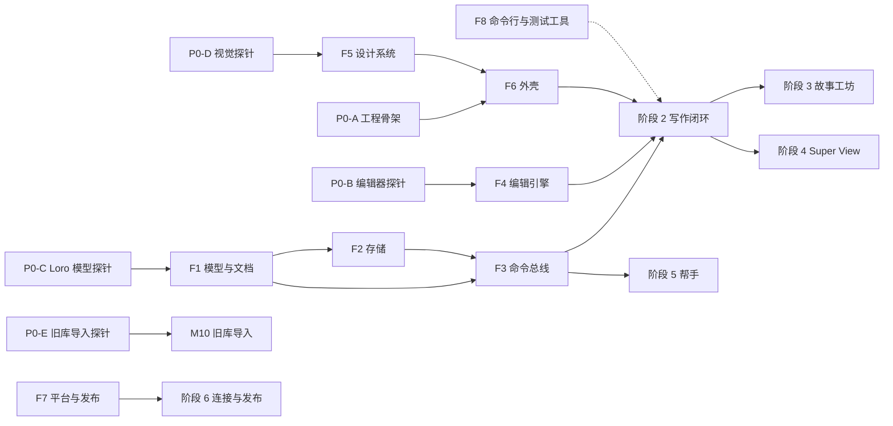

# 全 Rust 重写计划（GPUI + Loro）

2026-11-07 起草。作者的决定是：桌面端用 Rust + GPUI 重写，书和正文的数据改用 Loro；Tauri、TypeScript、Tiptap/ProseMirror、Yjs/yrs 都不再用；手机端短期不做。

本目录是这次重写的计划、拆分和基准：

- [foundation.md](foundation.md)：阶段 0 的探针与基座 F1–F8
- [modules.md](modules.md)：功能模块 M01–M43，以及每个模块对应的旧代码
- [benchmarks.md](benchmarks.md)：工作负载、性能预算、输入法矩阵和测量方法
- [research.md](research.md)：GPUI、Loro 与 Rust 生态的调研结论和来源
- [progress.md](progress.md)：各路会话现在做到哪了
- [simplifications.md](simplifications.md)：旧架构里不搬、合成一份、必须接住的东西，以及阶段 7 的清单

在新版能导入旧书之前，现有 Tauri 客户端照常维护，`AGENTS.md` 的规则对它照旧适用。

## 目标

1. 桌面端是一个原生 Rust 程序，没有 WebView，没有 JS。先做 macOS，再做 Windows。
2. 写作手感：
   - 按键在一帧内上屏；
   - 150 万字的全书打开、滚动、跳转都不卡；
   - 不操作时 CPU 接近 0。
3. 作者已有的书一本不丢，旧库能完整导入新版。
4. 顺带给社区：一个基于 GPUI + Loro 的中文长文富文本编辑器，做成独立 crate，用宽松许可证。

## 照旧不变的产品规则

这些规则在新版照旧，写进各模块的验收：

- 大纲是 幕 / 章 / H1 / H2 / H3。H1–H3 只叫 H1/H2/H3，在界面、提示词、导出和文档里一律如此，三级同等对待。
- 内部名 Drift 不变；中文叫「构想」，英文叫 Ideas。
- Agent 的写入直接生效，作者靠快照历史撤销。Agent 改动的结算记录要持久保存。
- 不做自定义右键菜单：
  - 对象的操作放在悬停卡底部；
  - 在空白处双击新建；
  - 正文选中文字时出现横向浮条。
- 下拉菜单和浮层浮在所有内容之上（相当于现在 portal 到 `body`）。
- 不用左侧竖条强调色，改用底色、间距或字重。
- 测试数据只用合成数据，或有再分发权的样书。

## 目标架构

新版放在仓库里一个新的 Cargo 工作区 `next/`，和旧代码并存。旧代码删掉以后，再把它移到仓库根目录。`native/` 这个目录名被已退役客户端的守护测试占着，不能用。

```text
next/
  app/drifting           可执行程序：窗口、路由，把各功能 crate 接起来
  crates/
    界面
      gpui-prose         正文编辑引擎。通用，准备开源，只依赖 gpui + loro
      dr-editor          Drifting 自己的编辑器扩展：人物链接、批注砂笔、大纲、Agent 改动显现
      dr-ui              设计系统：令牌、字体、砂笔图标、素玻璃、菜单、悬停卡、药丸、过渡
      dr-shell           三栏布局、标签与分栏、侧栏、Super View 舞台、快捷键、通知
      dr-view-*          各功能界面：书架、主页、时间线、Super View、设置、帮手面板……
    应用服务
      dr-workspace       命令、查询、事件总线；界面、Agent、MCP、命令行共用同一套命令
      dr-agent           帮手运行时，以及各家模型的接入
      dr-mcp             对外的 MCP 服务，以及调用扩展的客户端（rmcp）
      dr-sync            Hosted 账号、同步 v2、偏好同步、分享链接接口
      dr-export          EPUB / DOCX / PDF / Markdown / .driftingbook / 整库备份
      dr-mirror          Markdown 文件夹双向同步
      dr-import-v1       导入旧库（0.1.x）
      dr-samples         内置示例书（傲慢与偏见、阿Q正传）：新库首次运行写入一次
    数据
      dr-doc             Loro 文档结构：书目文档、正文文档、位置换算、锚点
      dr-store           SQLite：Loro 更新日志与快照、派生索引、资源文件、迁移与安全快照
      dr-model           领域类型、ID、不变量
      dr-text            字数统计、中文分词与断行、Markdown 读写、纯文本
    平台与工具
      dr-platform        钥匙串、深链接与单实例、日志、崩溃上报、自动更新
      dr-i18n            读取现有的 JSON 文案、复数规则、编译期检查文案键
      dr-cli             开发命令行：workspace call / inspect / scenario / seed
      dr-testkit         合成种子、基准程序、界面自动化
```

- **依赖方向只能自上而下**：界面 → 应用服务 → 数据。`gpui-prose` 不依赖任何 `dr-*`。
- **`dr-` 是并存期的临时前缀**，避免和旧的 `drifting-core` 等 crate 混淆。旧代码删掉后可以统一改名。

### 最大的一处简化

现在的同步引擎，是在 SQLite 行之上自己实现合并：

- 界面层 `src/renderer/sync` 约 3.5 万行 TS；
- 31 张同步表：变更集、归约器、校验内核、对象日志。

新版把作者写的、要同步的数据都放进 Loro 文档，合并交给 Loro。

- **书目文档**（每本书一个）放：
  - 书序和叙事序、幕的分界、构想分组；
  - 故事线、要素、分类、关系、时间钉、情节规划；
  - 批注和待办的元数据、写作日、项目事实与记忆。
- **正文文档**（每篇正文一个）放：章节、构想、要素正文、故事线和分类的说明、素材笔记。

SQLite 只存三类东西：

- Loro 的更新和快照；
- 派生索引：搜索、引用、字数；
- 只在本机的数据：帮手的运行记录、扩展、权限等。

代价有两点：

- 跨文档的写入没有原子提交；
- 合并之后的不变量（比如关系指向一个已删除的要素）要在命令层预防，或者读的时候容错。见 [foundation.md 的 F1](foundation.md#f1-dr-model-与-dr-doc)。

## 阶段总览

| 阶段 | 目标 | 过关标准 |
| --- | --- | --- |
| 0 地基与探针 | 先验证最可能失败的几件事：GPUI 上的中文编辑器、Loro 数据模型、没有背景模糊的素玻璃、旧库导入 | 编辑器探针过 [基准](benchmarks.md) 的探针档；Loro 结构定为 v0；作者选定视觉方案 |
| 1 基座 | 数据、命令、编辑器、设计系统、外壳、平台服务都可用 | 每个基座的验收和基准通过 |
| 2 写作闭环 | 作者能用新版日常写作（本机，用导入的旧库副本） | 作者用新版写一周；基准全绿 |
| 3 故事工坊 | 要素、人物链接、故事线、时间线、情节规划、构想、关系、审阅、素材、统计 | 每个模块对照 [modules.md](modules.md) 的旧版功能验收 |
| 4 Super View 与视觉 | 三个 Super View、字海、封面、热力图、沉浸写作、首次体验 | 作者先在原型上点头，再落地 |
| 5 帮手 | Agent 运行时、四家模型、工具、长任务、签到、MCP | 工具清单从命令注册表自动生成，并与旧版对齐 |
| 6 连接与发布 | 账号、同步 v2、偏好、分享、反馈、Markdown 文件夹、导出、更新交接、Windows | 旧版用户能升级过来；同步往返通过 |
| 7 切换与清理 | 发最后一个旧版，删掉 TS / Tauri / yrs，重建门禁；按 [simplifications.md 第七节](simplifications.md#七阶段-7-的清单) 的清单走，第一步是冻结旧库测试库 | 仓库里没有 TS；CI 全绿 |

阶段 3–6 不是严格先后。底座有了以后，它们大多可以同时推进，见下一节。

## 并行轨道



| 阶段 | 可以同时开几路 | 先后约束 |
| --- | --- | --- |
| 0 | 5 路：P0-A 到 P0-E | 互不依赖 |
| 1 | 5–6 路 | F1、F2、F4、F5、F7 同时开；F2 的存储格式跟 F1 的文档结构走；F3 等 F1/F2 的接口定稿（约一周）再开；F6 等 F5 的令牌和基础组件；F8 跟着 F3 和 F6 推进 |
| 2 | 4–6 路 | 每个模块一个 crate 或目录；都依赖 F3、F4、F6 |
| 3–6 | 6 路以上 | 模块之间几乎不碰同一批文件。帮手（阶段 5）在 F3 有了命令注册表以后就能开，不必等阶段 3；导出、Markdown 文件夹、同步这些不带界面的模块也可以提前 |

### 并行的规矩

- **基座 crate 各有一个负责会话**：`dr-model`、`dr-doc`、`dr-store`、`dr-workspace`、`dr-ui`、`dr-shell`。功能模块要改基座，就在基座的分支上改，先合进 `main`，再接着做模块。
- **一个会话一个 worktree，一个模块一个 crate 或目录**，两路会话不改同一批文件（沿用 `AGENTS.md`：在单独的 worktree 里开发验证，再本地合进 `main`）。
- **完成一个里程碑**，文档和可机器检查的验收证据一起提交。`next/` 的证据用更轻的做法：契约类当场由测试生成，测量类只在阶段关口提交，见 [simplifications.md 第五节](simplifications.md#五更轻的验收证据新工作区适用)。
- **合进 `main` 前，跑新工作区的检查**：`cargo fmt --check`、`cargo clippy --all-targets -- -D warnings`、`cargo test`，以及基准的 `--check`。
- **跨层的接口改动**（文档结构、命令注册表、组件 API）先改文档，再改代码。

## 适合亲手写的部分

如果想借这次重写练 Rust，下面这些最值得自己写，Agent 只做审阅和测试：

- F4 的文本存储与索引、排版与虚拟化、输入处理：所有权、trait、SumTree、并发都会用到；
- F1 的 Loro 文档结构，以及基于属性的测试；
- M22 要素全景的力导向布局（现在用 d3-force）；
- M24 字海的波动方程模拟，M25 书架封面的程序化绘制（tiny-skia）；
- 可选：M10 里自己写一个只读的 Yjs 解码器，作为理解 CRDT 的练习。

## 决定

2026-11-07 作者把推进交给监管会话，D1–D6、D8、D9 按建议定下；探针的结论可以推翻其中任何一条，推翻时在这里改并写明原因。D7 仍等作者，D10 到正式发布时再定。

| # | 问题 | 定了什么 | 状态 | 当时的备选 |
| --- | --- | --- | --- | --- |
| D1 | GPUI 怎么依赖 | 钉住 Zed 发布标签的 git 版本，现为 `v1.27.0`（2026-11-04）；每月按计划升级；需要挂补丁（比如输入法修复）时再开自己的 fork | 已定 | 精确钉住 `gpui-pre` 并用 gpui-component：起步快，但版本线和维护者都被锁定 |
| D2 | 素玻璃怎么做 | 不带背景模糊。P0-D 做了三个原型，作者让按性能优先定，选「遮盖」：GPU 铺上现有的玻璃纹理，用底色盖住中间只留一圈边，流动只挪纹理；浮起的玻璃改为不透明；底下不是平色的地方退回均匀细线。见 [spikes/p0-d-visual.md](spikes/p0-d-visual.md) | 已定（2026-11-07） | 改 GPUI 渲染器加模糊：要写 Metal / HLSL / WGSL 三份着色器，补丁得长期自己维护 |
| D3 | 正文的数据模型 | 每篇正文一个扁平的 LoroText，段落之间用换行分隔，段落属性记在换行符上（Quill 式）。P0-C 验证 | 已定，P0-C 验证通过（见 [loro-schema.md](loro-schema.md)） | 段落树（每段一个 LoroText）：回车拆段时，光标和锚点会断 |
| D4 | 批注锚点 | 批注用一对 Loro 光标存位置，元数据放书目文档；格式和人物链接用标记。P0-C 验证 | 已定，P0-C 验证通过；撤销删除不会让批注展开回来，要编辑器把锚点带进撤销项（F4） | 批注也用标记：删掉后仍留在正文数据里，数量多了读取会变慢 |
| D5 | 旧库的正文怎么读 | 新版直接读旧库：结构化表、正文缓存 `content_json`、批注锚点、快照历史的预览都不需要 Yjs。缓存可能缺最后几秒的字，所以旧版加「交接」（已实现，见 [docs/v2-handoff.md](../v2-handoff.md)）：每次启动和退出时把正文从 Yjs 重新写进缓存，在 `library_state` 记下每篇的版本号和缓存的哈希，连同 WebView 里的设置。不另做交换文件。见 [P0-E 结论](spikes/p0-e-import.md) | 已定（2026-11-07，作者同意 P0-E 的建议）；旧帮手对话只读搬过去、没交接的库默认拦住并给「仍然导入」，作者也已同意 | 自己写只读的 Yjs 解码器：好的练习，但要实现 Yjs 的排序才能还原正文；旧版导出交换文件：多一种只用一次的格式 |
| D6 | 同步 v2 | 沿用现在的对象日志 HTTP 协议，换一个命名空间承载 Loro 的更新和快照。服务端只存不透明对象，几乎不用改 | 已定，阶段 6 实现 | Loro 的 WebSocket 协议：能实时协作，但它的 Rust 服务端还只是骨架 |
| D7 | Hosted 服务端 | 服务端现在用 Better Auth（TypeScript）。「完全去掉 TS」包不包括服务端，单独再定；客户端计划不依赖这个决定 | 等作者 | — |
| D8 | 分享阅读页 | 用 Rust 在服务端直接出 HTML（axum + maud），和导出共用「正文转 HTML」的代码，页面零 JS；跑在哪里随 D7 定 | 已定 | 用 Leptos islands：等需要实时评论时再加 |
| D9 | 版本线 | 新版从 0.2.0 起，有自己的数据库基线；0.1.x 的兼容承诺留给旧版，旧用户通过 M10 导入过来 | 已定 | — |
| D10 | Windows 签名 | alpha 期间照旧不签名。正式发布时选 OV 证书 + 云 HSM，或者 SignPath。Zed 用的 Azure Artifact Signing 只给美国、加拿大的个人开发者发身份 | 正式发布时再定 | — |

## 主要风险

1. **GPUI 只为 Zed 服务。**
   - 现状：不发 crates.io（上面的 0.2.2 已是一年前），每周都有破坏性改动，没有 Zed 用例的功能不收。
   - 对策：钉住版本、按月升级；平台相关的部分（文字排版、输入法、窗口、菜单）收进一层薄封装。
2. **中文输入法。**
   - 现状：
     - Zed 在 2026-11-06 把「中文输入法时灵时不灵」以不修关闭，对应的修复 PR 没有合并；
     - macOS 上判断当前输入法的规则会被微信、搜狗、百度输入法骗过；
     - Windows 走的是 IMM32，不是 TSF。
   - 对策：自带补丁；编辑器里不绑定单个可打印键；失焦时自己清掉组字；输入法矩阵进基准。
3. **GPUI 缺少视觉原语。**
   - 现状：不能给单个元素做背景模糊，没有自定义着色器，`div` 不能做变形，渐变只有两种颜色，透明度不是整组生效。
   - 对策：素玻璃见 D2；字海、封面、砂笔纹理先用 CPU 画（tiny-skia），再作为位图贴上去。
4. **Loro 还在快速修 bug。**
   - 现状：
     - 富文本撤销有未修的问题（#1229、#1228、#1245）；
     - 导入和回看历史会把整段历史展开进内存，而且不释放；
     - Rust 接口有破坏性改动。
   - 对策：精确钉住 `loro = "=1.17.1"`；在 `dr-doc` 的边界上做属性测试和模糊测试；回看历史时从 SQLite 另载一份副本，用完就丢（P0-C 实测 `fork_at` 不能避免打开的文档本身膨胀）；撤销合并间隔设 0，由编辑器自己合并（绕开 #1228、#1245）。
5. **富文本编辑器要全部自己写**：选区、输入法、撤销、查找、复制粘贴、无障碍。
   - 对策：阶段 0 先做探针；探针过不了就停下来重新评估。
6. **旧用户的迁移。**
   - 现状：正文、批注锚点、快照历史都存在 Yjs 里。
   - 对策：自动更新要从 Tauri 交接给新程序，所以要保留 bundle id `cc.drifting.client`、Windows 的安装位置和 minisign 公钥。
7. **帮手是最大的一块 TS。**
   - 规模：运行时约 7.2 万行，界面和存储约 2.4 万行。
   - 外部条件：Anthropic 没有官方 Rust SDK；Rust 生态的 reqwest 分裂在 0.12 和 0.13 两个大版本。
8. **整体规模**：TS 约 43 万行，其中测试约 13 万行。好在不少原生部分已经是 Rust、可以直接复用：PDF 排版、图片处理、MCP 服务、OpenAI 与 ChatGPT 订阅的接入、钥匙串、整库备份。
