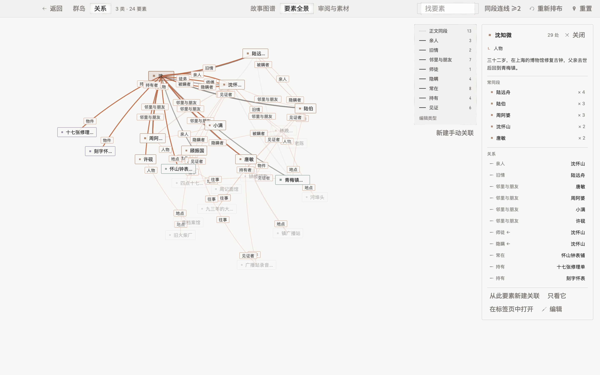
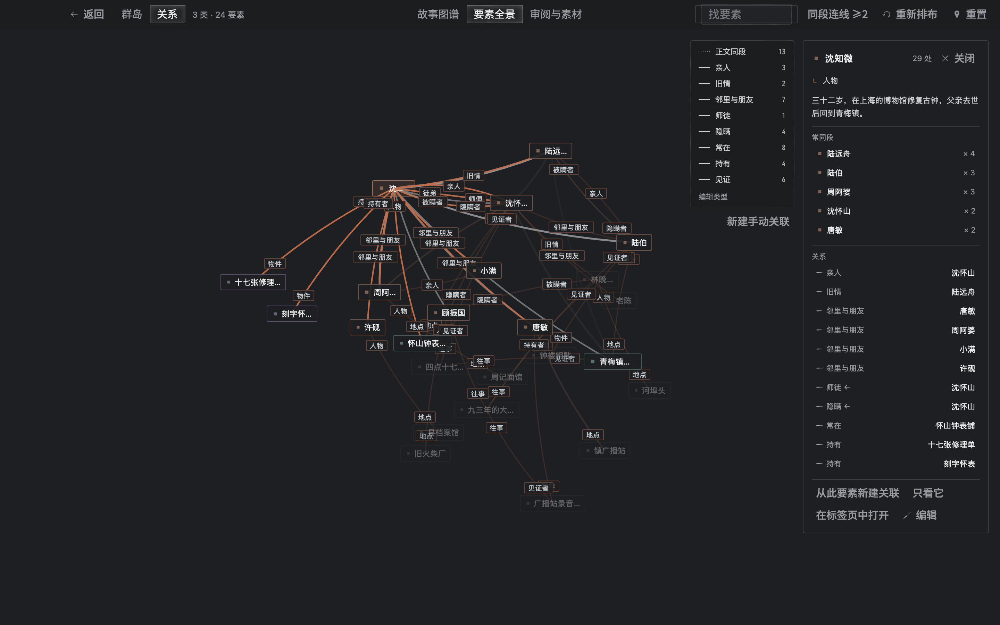
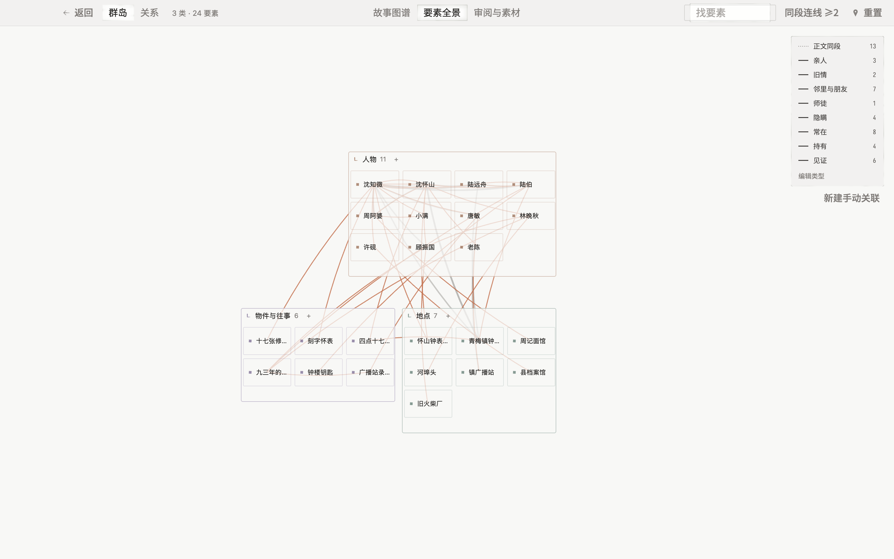
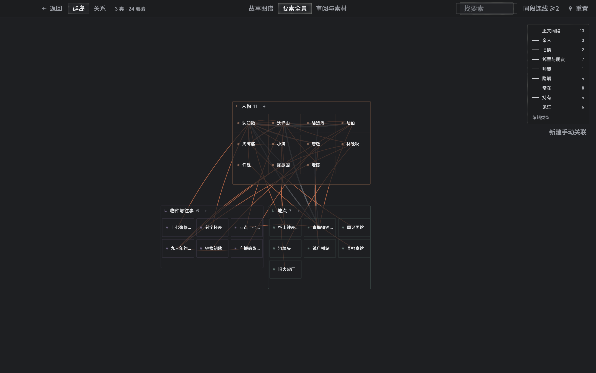

# M22：要素全景 Super View（`dr-view-element-overview`）

`SuperView::Elements`（工作台快捷键 `⌘⌥4` / 切页器「要素全景」）在同一张全窗口画布上提供**「关系」**（默认）与**「群岛」**两种布局，直接建立在 canonical v3 书目模型（`Entry`、层级 `LevelSettings`、多归属 `Membership`、显式 `Relation` / `RelationType`、`EntryLayout::relation_graph` 与真实段落引用索引）之上。已按规范移除旧版扁平章节出现带，不引入任何书序轴或幕假设。

## 结构与职责划分

- **`next/crates/dr-workspace/src/cooccurrence.rs`（v3 同段共现与提及查询）**
  - `Workspace::entry_cooccurrences(book)` 先通过 `flush_book_prose_indices` 刷入当前书打开中或待更新的 `body:<entry>/<module>` 正文派生索引，再读取 `Library::entry_module_references_in_book`。
  - 仅统计源条目与目标条目均存活（未进回收站）且 `target_kind == "entry"` 的 `Link | Mention` 引用：引用次数计入目标条目的总提及数；当两个不同存活条目在同一 `(source_doc, source_block)` 非空段落块内同时出现时，记一次真实同段共现；`source_block == None` 的记录只计提及次数，绝不拼凑伪同段。
- **`next/crates/dr-view-relations/src/legend.rs`（共享关系图例）**
  - 提供无状态共享组件 `Legend` / `Row` / `render`，在内容区右上角统一绘制「正文同段」砂线开关、各 `RelationType` 颜色图例与计数显隐开关、「编辑类型」与「新建手动关联」入口，供全景视图复用。
- **`next/crates/dr-view-element-overview`（M22 舞台）**
  - **确定性力导向「关系」布局（`relate.rs`）**：纯 Rust 实现，固定步数（首算 240 步，拖动固定重热 `alpha = 0.35`），初始扰动由 `EntryId` 的 FNV-1a 哈希驱动 `splitmix64`，保证同一本书每次冷算坐标逐位一致。合力包含四项：显式 `Relation` 弹簧、同段共现弱弹簧、按窗口宽高比缩放的所属岛位弱锚点、以及带文字宽度的矩形防重叠分离与斥力。弧线采用二次贝塞尔曲线，有向关系在两端绘制 `source_role` / `target_role` 角标，对称关系在中点绘制类型名；当可见关系边超过 60 条或缩放到远景时，自动收敛角标与远景姓名（仅保留提及最多的前 12 个要素、当前聚焦要素及其一跳邻居）。
  - **确定性「群岛」分箱布局（`isles.rs`）**：从 canonical v3 读取 `display == "island"` 根下的分类子层级及独立的 `auto_link && !is_manuscript` 非泳道层级，区分本层常住条目（`residents`）、子层级分组与 `accept == true` 收入的归属成员（`members`），对多归属要素在「关系」模式下去重并在「群岛」模式下按 `(island_id, group_idx, entry_id)` 独立赋予交互标识。双带货架装箱（`Top` / `Bottom`）平衡总宽；画布支持远／中／近三档缩放 LOD，印章尺寸随提及次数对数权重缩放。
  - **页眉双槽与按书本机记忆（`view.rs`）**：`head_start` 槽左侧放置「群岛 / 关系」分段切换器，右侧显示 `{{categories}} 类 · {{elements}} 要素`；`head_end` 槽提供要素搜索定位、同段连线阈值（`≥1 / ≥2 / ≥3 / ≥5`）、「重新排布」与画布重置。`Workspace::book_memory("element-overview")` 按书将当前模式、连线阈值、隐藏关系类型、浮岛抽屉宽度比例及带弹簧拓扑签名的落定坐标存入 `local_state`：新书默认打开「关系」，上次停在「群岛」的书重开仍回到「群岛」；拓扑未变时重开走 `520 ms` 平滑过渡到上次位置。
  - **守卫写入与 G1 / G2 复用（`view.rs`、`view/island.rs`、`view/relations.rs`）**：
    - 在「关系」画布拖动要素卡片松手即固定：通过 `dr_view_elements::data::v3::prepare_edit` 写入 `Entry.layout.relation_graph`，原样保留同一条目的 `EntryLayout::board` 与 `EntryLayout::grid`；浮岛小卡点「恢复自动排布」即清除 `relation_graph`。
    - 在「群岛」画布把要素拖到另一座岛：直接复用 G2 的 `dr_view_elements::data::v3::{drop_target, prepare_drop}`——目标层级 `accept == true` 时添加 `Membership`，`accept == false` 时移动常住父层级 `Entry.parent`，并完整接入工作区 `undo`。
    - 关系增删与类型管理：支持 `Shift + 点击` 两要素（或从浮岛小卡点「从此要素新建关联」）弹出建边面板，点击关系边弹出详情／删除气泡，以及关系类型增删面板（走 `relation.create`、`relation.delete`、`entry_relation_type.put`、`entry_relation_type.delete`）。
    - 浮岛小卡与内嵌 G1 编辑器：点击要素或岛头在右上角打开 Peek 小卡（展示提及次数、所属类目、前 5 名常同段同伴、双向关系列表、「只看它」邻域隔离、「在标签页中打开」与「编辑」）；点「编辑」原地展开可拖宽的右侧浮岛抽屉并直接挂载 G1 的 `dr_view_page::EntryPage`，不复制第二套字段或正文编辑器。

## 生命周期与释放屏障

- 注册 `dr_shell::release` 释放钩子：`before_release` 同步置位冻结门（拦截拖动固定、跨岛拖放、建边与展开编辑器），卸载内嵌 `EntryPage`、取消过渡动画并释放 `Workspace` 引用，确保换库或退出时 `try_shutdown` 零泄漏通过；`after_release` 从当前 `Services` 重新绑定并恢复交互。

- **只在显示时跟着书变（2026-11-13）**：全景经 `dr_shell::pages::follow_super_view` 跟工作区。以前舞台关掉以后，每次书目变动它仍在主线程整份重读（岛屿、布局、关系、全书共现查询）；现在关着时什么都不读，再显示时一次补齐。切到另一本书时，给上一本书留着的全景不再跟过去，新书的全景由舞台另做。测试 `a_closed_overview_does_not_follow_the_book_and_catches_up_when_shown`。

## `showcase` 样书实拍（《慢钟》）

| 模式 | 浅色（Light） | 深色（Dark） |
| --- | --- | --- |
| 关系（默认布局 + 浮岛小卡） |  |  |
| 群岛（分类装箱 + 砂线与关系弧） |  |  |

## 验证与 `Preset::Heavy` 参考耗时

- **单元与 GPUI 契约测试**：
  - `dr-workspace::cooccurrence::tests`：验证真实同段共现计数、同篇跨段不误连、`source_block == None` 仅计提及不拼伪同段、以及回收站条目即时排除。
  - `dr-view-element-overview`（6 项纯算法测试 + 5 项 GPUI 集成测试）：验证跨库同种子力导向坐标逐位一致、`book_memory` 模式与坐标恢复及双书隔离、跨岛拖放复用 G2 `prepare_drop`（`accept: true` 归属与 `accept: false` 迁居）及撤销、`relation_graph` 固定／解固保留 `board` 与 `grid`、`Shift` 建边与图例过滤及删除、浮岛小卡邻域隔离与展开挂载 G1 `EntryPage` 及 `library::replace` 释放屏障。
- **调试桥副屏真窗口验收**：在 `showcase` 种子《慢钟》上走通 68 步零挂起场景（默认「关系」打开、点选《慢钟》人物弹出小卡、展开内嵌 `EntryPage` 抽屉再收起、切「群岛」、浅深色重开验证 `book_memory` 恢复、在「关系」画布真鼠标拖动固定并出现「恢复自动排布」、在「群岛」画布真鼠标把要素拖入另一座岛并校验落盘 `parent`）。
- **`Preset::Heavy` release 空闲实测与优化对比**（约 165 万字符、300 要素、28,468 处实体链接、12,187 对真实同段共现；`cargo test --release --locked -p dr-view-element-overview --test element_overview heavy_seed_reference_timings -- --ignored --nocapture`，机器空闲 `load1m < 4.0`）：
  - **不改格式与行为的热路径优化**：`dr-workspace::cooccurrence` 改用稠密存活条目 `u32` 下标与打包 `u64` 键去重计数；`relate.rs` 复用空间哈希网格桶消除 240 步 × 300 节点的每步 `HashMap<_, Vec<_>>` 分配；`dr-doc::v3` 的 `relations_raw` 改为标量字段遍历；`OverviewView` 消除建窗期的重复初次加载与拖动固定后的重复收敛，并对「正文同段」砂线与关系弧启用视口裁剪及分档透明度合并 `PathBuilder::stroke` 批绘（同时 `dr-ui::glass::paint_rim` 对滚出遮罩的玻璃框提前裁剪）。
  - **开书进入首帧（`open_first_frame_ms`，含同段共现查询、300 节点 / 12,187 对弹簧 240 步冷算落定与首帧绘制）**：优化前（`load1m 3.47 → 3.31`）`160.47 ms` → 优化后（`load1m 3.22–3.64`）**`87.30–91.62 ms`**（满足 `benchmarks.md` Super View 首开 `≤ 100 ms` 发布档预算；视图挂载至首帧 `first_frame_ms` 由 `99.29 ms` 降至 **`73.48–76.80 ms`**）。
  - **单帧绘制（30 帧）**：优化前 `p50 = 12.24 ms`、`p95 = 14.60 ms` → 优化后 **`p50 = 8.93–9.35 ms`、`p95 = 9.46–11.22 ms`**（满足 60 Hz `≤ 16.7 ms` 与 Super View 最差帧 `≤ 100 ms`）。
  - **拖动固定后重热落定并持久化（`pin_reheat_settle_ms`）**：优化前 `372.02 ms` → 优化后 **`252.32–261.44 ms`**。
  - *附注*：早先在宿主机高负载（`load1m ≈ 10.6–12.0`）下测得的参考值为首帧 `387.78 ms`、单帧 `p50 = 27.28 ms` / `p95 = 45.27 ms`、重热持久化 `876.98 ms`，现已被上述空闲实测正式替代。

## 待协调／待作者

- 旧版扁平「章节出现带」已按规范移除；在 canonical v3 任意深度文稿树下，要素浮岛小卡是否需要新增可选的文稿树提及分布摘要，已记入 [progress.md 的「等作者的事」](../progress.md#等作者的事)（作者 2026-11-11 定：暂缓，并入视觉打磨），本模块不自行设计替代条带。
